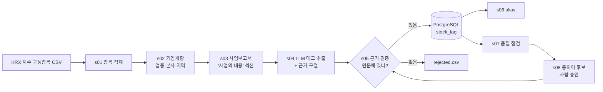

# StocksTag

**KOSPI200 · KOSDAQ150 종목에 공시 근거가 있는 세부 속성 태그를 붙이는 파이프라인**

"반도체" 같은 섹터 수준이 아니라 `HBM TC 본더`, `데이터센터`, `MLCC`, `초전도 선재`처럼 구체적인 품목·응용처·고객사·리스크 요인까지 태그로 만든다. 모든 LLM 태그는 사업보고서 원문 구절(evidence)을 근거로 갖고, 그 구절이 원문에 실제로 있는지 프로그램이 검증한 것만 저장한다.

실시간 주가 급등락을 감지해 가장 연관성 높은 뉴스를 푸시하는 서비스에서, **"이 뉴스가 이 종목과 왜 관련 있는가"** 를 판단하는 기반 데이터로 쓰인다.

---

## 예시: 한미반도체 (042700)

| 축 | 태그 | 근거 (사업보고서 원문) |
|---|---|---|
| product | HBM TC 본더 | 당사의 주력 장비 'HBM TC(Thermal Compression) 본더'는 메모리칩에 정밀한 열과 압력을 가해… |
| application | AI 서버, 데이터센터 | AI 서버와 데이터센터 투자 확대에 따라 고대역폭 메모리(HBM) 수요가 급증하고 있으며 |
| customer | SK하이닉스, Micron | 현재 당사가 확보하고 있는 고객사로는 글로벌 반도체 기업인 SK하이닉스, Micron Technology… |
| exposure | 환율 | 시장위험은 환율, 이자율 및 지분증권의 가격 등 시장가격의 변동으로… |

`application = 데이터센터` 태그가 붙은 종목은 삼성SDI, 한미반도체, 가온칩스, 대한전선, 이수페타시스 등 49개다. "데이터센터 투자 확대" 뉴스가 나오면 회사 이름이 기사에 없어도 이 종목들과 연결할 수 있다.

## 태그 축

| 축 | 내용 | 예 |
|---|---|---|
| `product` | 만들거나 파는 구체적 품목 | HBM TC 본더, 카메라모듈, 바이오시밀러 |
| `application` | 전방 산업·응용처 | 데이터센터, 전기차, AI 서버, 조선 |
| `customer` | 원문에 이름이 나온 주요 고객사 | 삼성전자, SK하이닉스, Apple |
| `raw_material` | 주요 원재료·부품 | 니켈, 웨이퍼, CCL/PPG |
| `region` | 본사·생산설비 소재지 (시/도, 국가) | 경기, 충남, 베트남 |
| `exposure` | 실적 변동 요인 + 방향(+1 유리 / -1 불리) | 환율, 유가, 금리 |
| `industry_code` | 표준산업분류 코드 (OpenDART) | 264 |

종목 이름의 다른 표기(삼전 → 삼성전자, SK hynix → SK하이닉스)는 `stock_alias`에, 태그의 다른 표기(적층세라믹콘덴서 → MLCC)는 `tag_synonym`에 들어 있다.

## 파이프라인



## 현재 결과 (2026-11-18)

| 항목 | 값 |
|---|---|
| 대상 | 351종목 (KOSPI200 201 + KOSDAQ150 150) |
| LLM 태그 | 6,666개 적재, 근거 검증 거부율 5% |
| 종목당 평균 | product 6.2 · region 4.6 · application 3.6 · raw_material 3.3 · customer 3.2 · exposure 2.6 |
| 두 번 추출한 결과의 일치도 (Jaccard) | raw_material 0.64 · region 0.63 · exposure 0.60 · product 0.55 · customer 0.52 · application 0.42 |
| 동의어 사전 | 254행 (사람이 승인한 것만) |
| alias | 1,023개, 충돌 0건 |

LLM은 Google `gemini-3.5-flash-lite` 무료 할당량으로 돌렸다. OpenAI 호환 API(Gemini, OpenAI, Ollama)와 Anthropic API 중 `.env`로 고를 수 있다.

## 빠른 시작

### 1. DB만 필요할 때 (덤프 복원)

[Releases](https://github.com/Laattae/StocksTag/releases/tag/v0.1-tags)에서 `stocktag.dump`를 받는다.

```bash
docker run -d --name stocktag-pg -e POSTGRES_USER=stocktag -e POSTGRES_PASSWORD=<비밀번호> -p 5432:5432 postgres:16
docker exec -i stocktag-pg pg_restore -U stocktag -d stocktag --no-owner < stocktag.dump
```

### 2. 저장소 파일로 다시 쌓을 때 (LLM 호출 없음)

사업보고서 섹션(`data/reports/`)과 LLM 결과(`data/llm/`)가 저장소에 들어 있어서 OpenDART 키만 있으면 된다.

```bash
pip install -r requirements.txt
cp .env.example .env            # DART_API_KEY, DATABASE_URL 채우기
psql "$DATABASE_URL" -f sql/01_schema.sql
python -m src.s01_load_stocks --index KOSPI200=data/KOSPI200.csv --index KOSDAQ150=data/KOSDAQ150.csv
python -m src.s02_company_info
python -m src.s03_fetch_reports
python -m src.s05_load_tags
python -m src.s06_build_aliases
python -m src.s07_report        # 품질 점검
```

단계별 설명, 통과 기준, 운영 메모는 [docs/PIPELINE.md](docs/PIPELINE.md)에 있다.

## 사용 예 (SQL)

```sql
-- 기사에서 찾은 단어 → 관련 종목과 근거
SELECT s.name, t.axis, t.value, st.weight, st.direction, st.evidence
FROM tag t
LEFT JOIN tag_synonym ts USING (tag_id)
JOIN stock_tag st USING (tag_id)
JOIN stock s USING (stock_code)
WHERE t.value = ANY(ARRAY['HBM', '데이터센터']) OR ts.synonym = ANY(ARRAY['HBM', '데이터센터'])
ORDER BY st.weight DESC;

-- 종목별 축마다 상위 5개 태그만
SELECT * FROM stock_tag_topk WHERE stock_code = '042700';
```

## 주요 테이블

| 테이블 | 내용 |
|---|---|
| `stock` | 종목코드, 이름, corp_code, 지수, 업종 |
| `tag` | 태그 사전 (axis, value). 같은 값은 한 번만 정의 |
| `stock_tag` | 종목-태그 연결. `weight`(중요도), `axis_rank`, `direction`, `evidence`(근거 원문), `rcept_no`(근거 공시) |
| `tag_synonym` | 태그 동의어 → tag |
| `stock_alias` | 종목 이름 표기 → 종목 |
| `report_source` | 종목별 사용한 사업보고서 |

스키마: [sql/01_schema.sql](sql/01_schema.sql)

## 원칙

- 태그는 공시 원문에 근거가 있는 것만 저장한다. 근거 검증은 끄지 않는다.
- 표기 통일은 사람이 승인한 동의어 사전(`data/tag_synonyms.csv`)으로만 한다. 띄어쓰기·대소문자만 다른 표기는 자동으로 합친다.
- 모든 단계는 다시 실행해도 같은 결과가 나온다.
- API 키는 `.env`에만 둔다.

## 한계와 다음 단계

- 근거 검증은 "구절이 원문에 있는가"만 확인한다. 그 구절이 태그를 실제로 뒷받침하는지는 사람 검수(`data/review_sample.csv`)로 잰다.
- 사업보고서 기준이라 1년에 한 번 갱신된다.
- `application` 축은 일치도가 0.42로 가장 낮다. 프롬프트 개선(v3)과 동의어 정리를 이어서 한다.
- 다음 단계는 뉴스 매칭이다: 기사 속 종목·태그 언급을 찾고, 급등락 시점에 후보 기사를 LLM으로 재순위해 푸시한다. 설계는 [docs/PIPELINE.md](docs/PIPELINE.md#다음-단계-급등락--뉴스-연결-설계) 참고.

## 데이터 출처

- [OpenDART](https://opendart.fss.or.kr) 기업개황·사업보고서 (금융감독원 전자공시)
- [KRX 정보데이터시스템](http://data.krx.co.kr) 지수 구성종목

SSAFY 최종 프로젝트의 일부.
